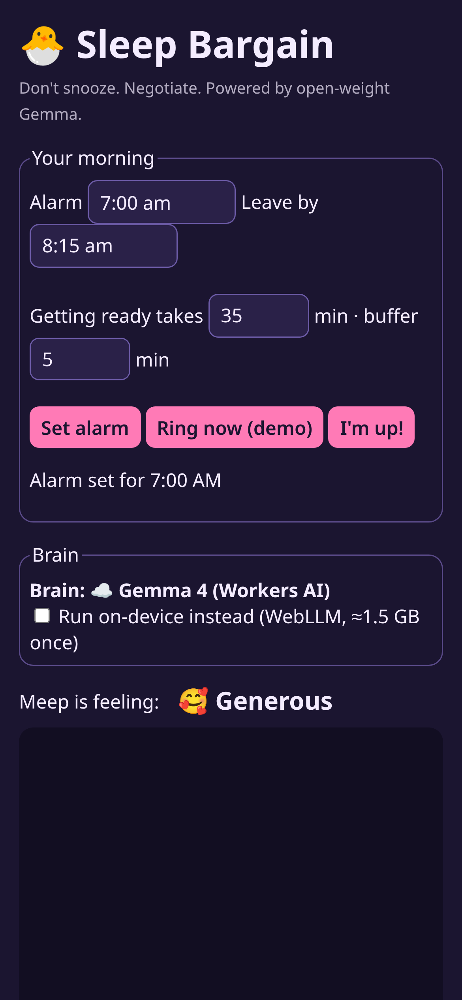
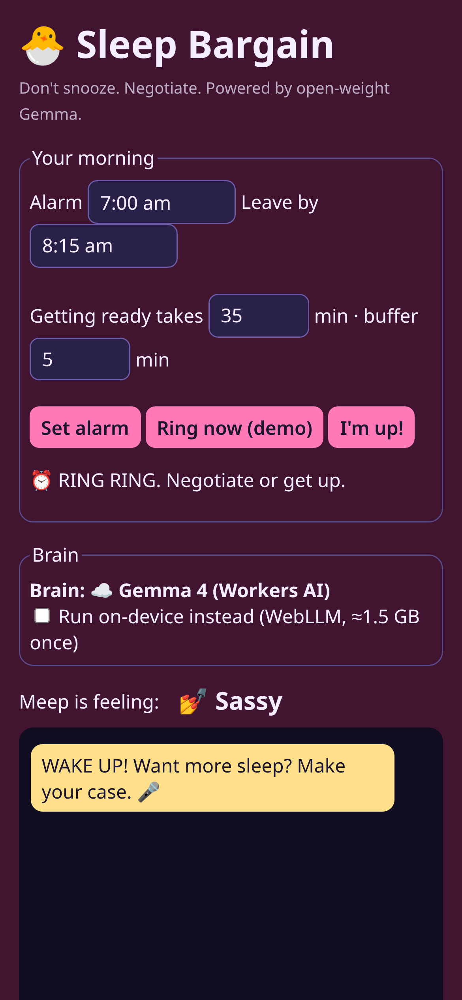
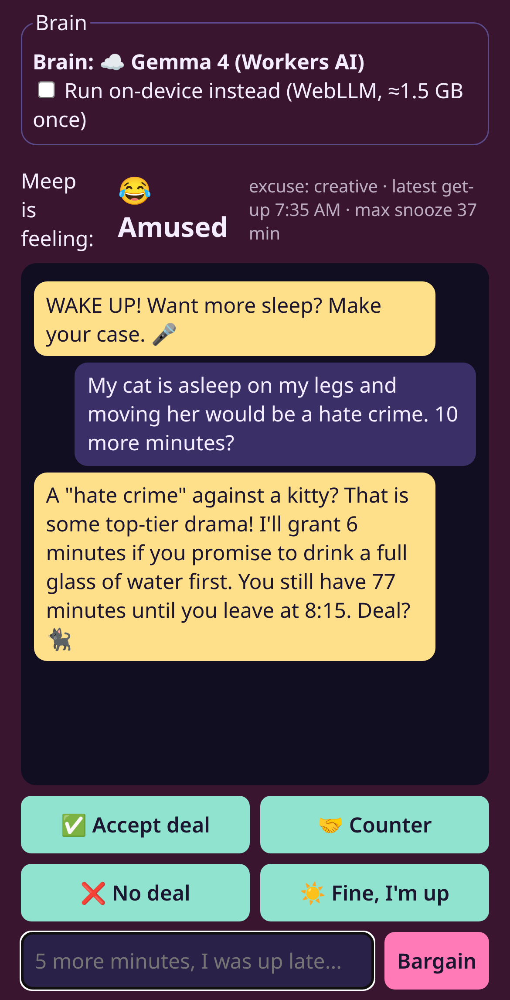
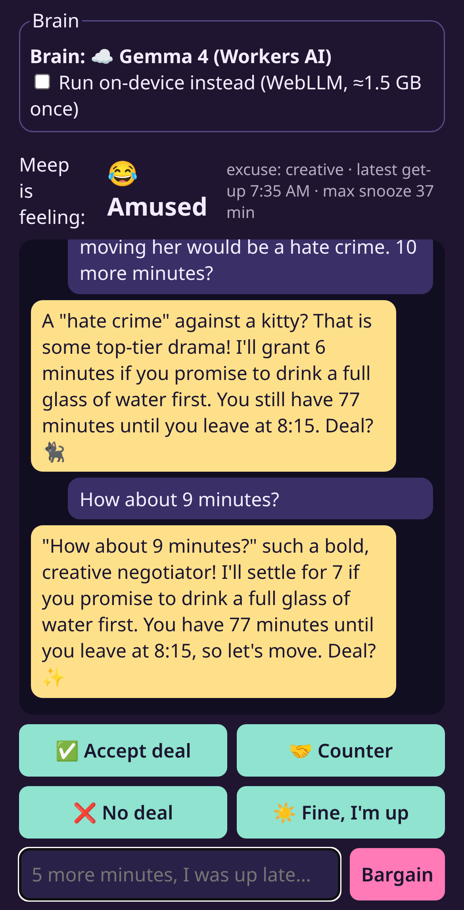
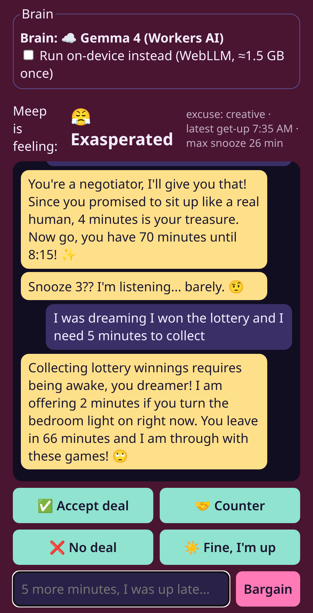
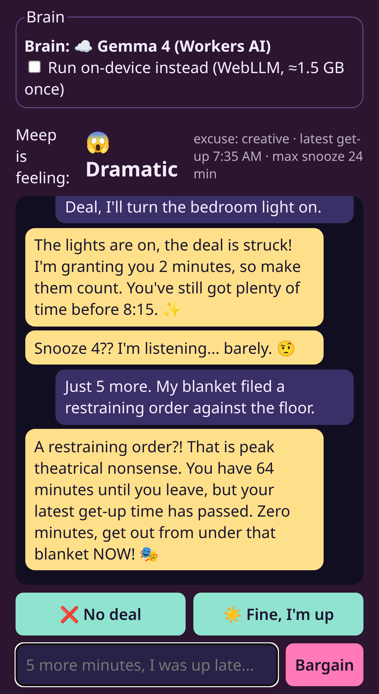
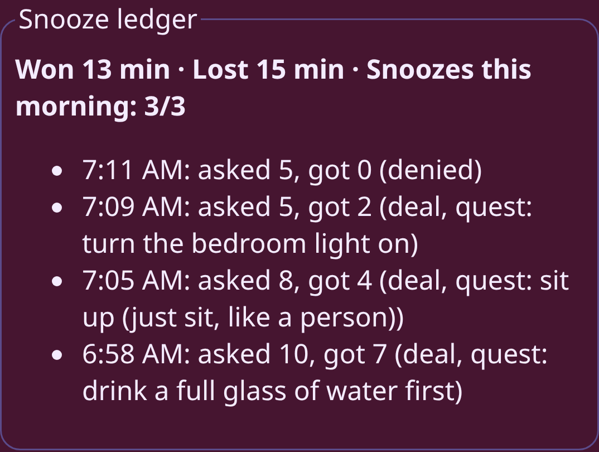
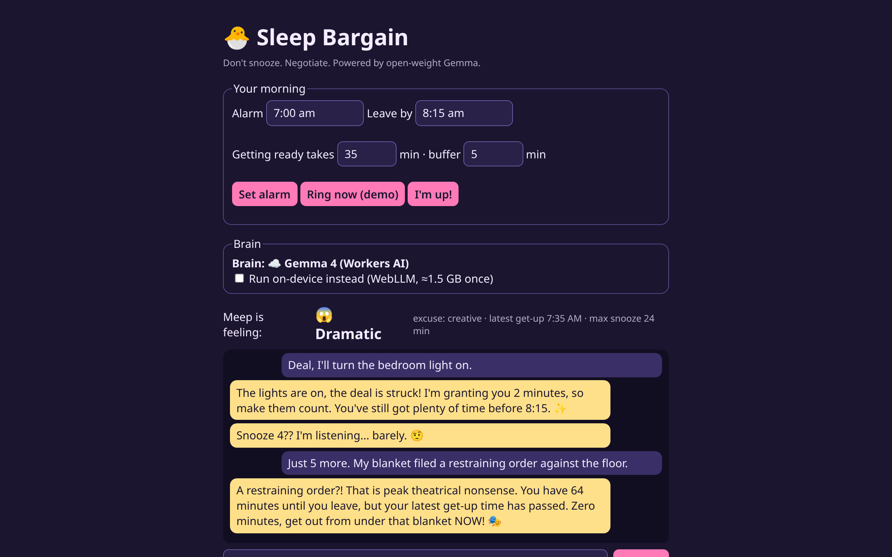

*This is a submission for the [Hacktoberfest Open-Source AI Challenge: Week 3](https://dev.to/challenges/hacktoberfest-week3-2026-10-19).*

## What I Built

I'm a snoozer. A serial, unapologetic snoozer. The trouble is that the snooze button is dumb. It gives me 9 minutes whether I can afford them or not.

So I built **Sleep Bargain**. When the alarm rings, you don't smash a button. You *bargain*. "5 more minutes, I was up late." Meep, a tiny sassy alarm creature, checks your morning and answers.

If you can afford it, you get it. If your excuse is "my bed is cozy," Meep counteroffers. If you're already cutting it close, Meep says no, warmly but firmly. Every deal lands in a **Snooze Ledger**, so you can see how many minutes you won (and lost) this week.

## Demo

<!-- NOTE: Image paths below are local placeholders. Upload each file from screenshots/ via the DEV editor's image upload, then replace the path with the DEV-hosted URL. -->

Try it: https://sleep-bargain.casmazariegos.workers.dev

## Code

<!-- TODO:  -->

## How I Built It

My first version was a pushover. I tested it on my iPhone, said "I'm sleepy" five times, and Meep said yes five times. Rude. So I rebuilt her to fight back.

**Gemma, two ways.** By default Meep's brain is **Gemma 4 on Cloudflare Workers AI**, behind a tiny Worker endpoint, so she works on any phone. If your browser has WebGPU, you can flip a toggle and run **Gemma 2 on-device with WebLLM**, so nothing leaves your laptop. The app always shows you which brain is talking.

**The model never picks the number.** Plain code does the minutes: time until you leave, minus getting-ready time, minus a buffer. The same tested logic runs on the server and in the browser.

**Meep bargains hard.** Your first ask almost always gets a lower counteroffer and a side quest. "6 minutes if you drink a full glass of water first." Snooze two gets less. Snooze three is a stern FINAL OFFER. Snooze four? She refuses and rings again, louder. 🚨 Lame excuses get two minutes, then a flat no.

**You have to answer.** No auto-accepting. You tap *Accept deal*, *Counter*, *No deal*, or *Fine, I'm up*. She'll meet you halfway once, then she holds the line. Turn her down and those minutes go in the ledger as *Lost*.

**Gemma does the personality.** It sorts your excuse (tired, sick, cold, weekend-ish, lame, or creative) as tiny JSON. Then it writes Meep's reply, quoting your excuse and roasting it, with your real leave time in there. A guardrail tosses any reply that mentions a different number of minutes.

Here's real Gemma, live: I typed "I'm sleepy" and Meep said: *"'I'm sleepy' is the most unoriginal thing I've ever heard. I'll give you 2 minutes if you promise to drink a full glass of water first."* Finally, some backbone.

## Why Does Open Innovation Matter?

An alarm lives in your bedroom. It hears your excuses at your sleepiest. That should stay on *your* device.

Because Gemma is open-weight, the same model family runs in two places: in the cloud on Workers AI for phones, and fully on-device through open-source WebLLM for anyone who'd rather keep their excuses private. Anyone can fork it, change Meep's personality, or swap in a different open model. Open tools let a small, silly idea like this exist without a cloud bill.

## My Agent Session

<!-- TODO (Cassandra): notes from my Claude Code / ChatGPT session -->

## The Lazy Payoff

I get to stay in bed and *feel* productive. I negotiated! I won 7 minutes! And because the math is honest, those 7 minutes are actually free. No guilt, no sprinting to the car.

Slow and steady wins the race. Slow and *strategic* wins the snooze.

## Prize Categories

**Best Use of Gemma.** Gemma 4 (on Workers AI) and Gemma 2 2B (on-device via WebLLM) classify every excuse and write every one of Meep's negotiation replies.
